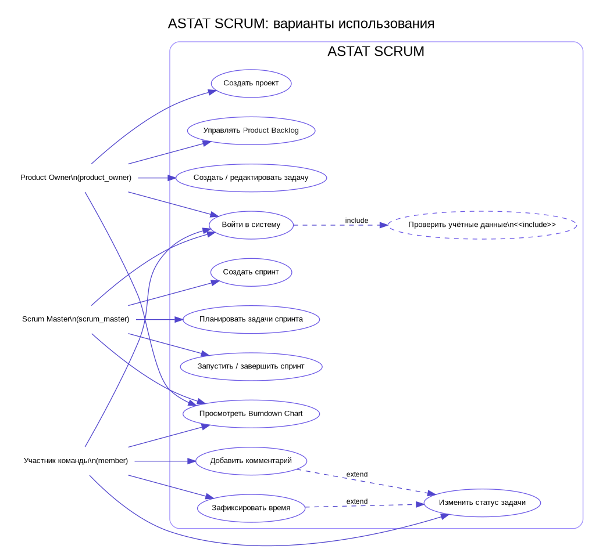
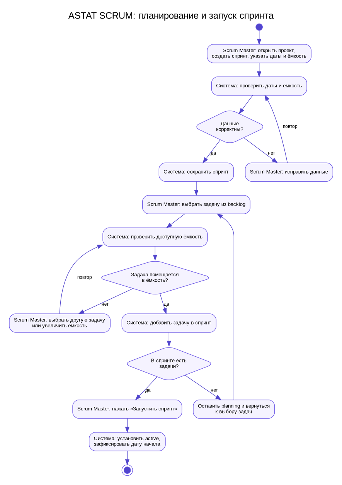
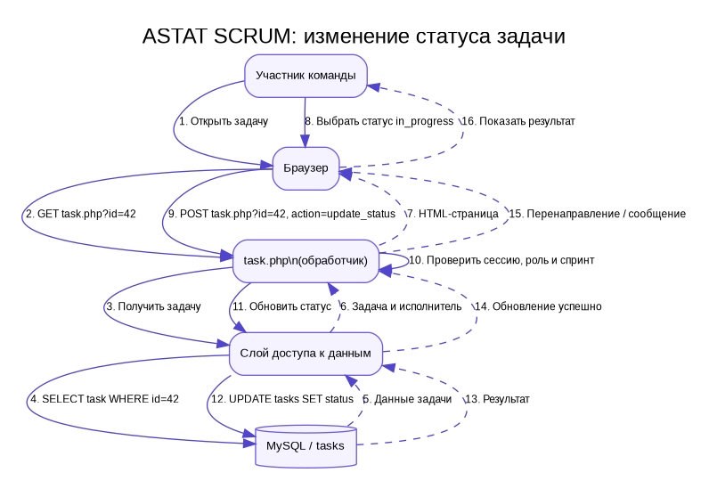
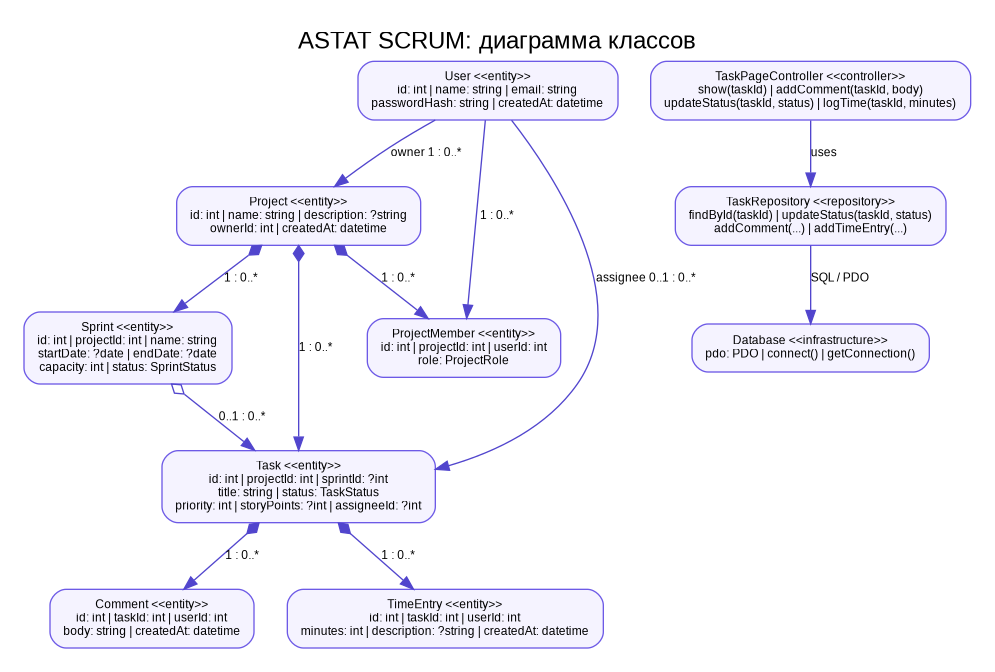
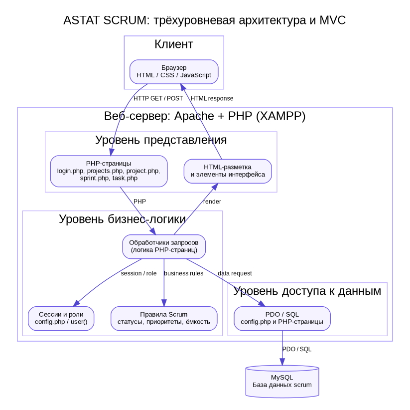
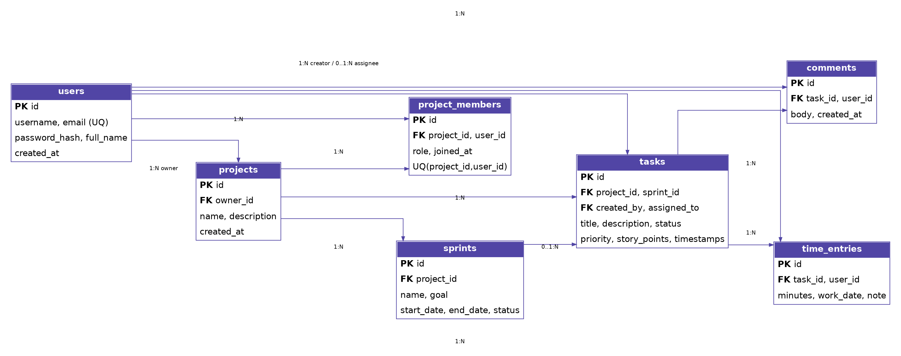
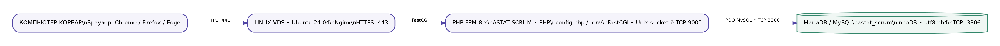

# Техническое задание на разработку информационной системы ASTAT SCRUM

**Версия:** 1.0  
**Дата:** 16.11.2026  
**Исполнитель:** Зоидов Миркомил  
**Заказчик:** условная проектная команда ASTAT SCRUM  
**Тип документа:** учебное техническое задание, подготовленное с учётом структуры ГОСТ 34.602

---

## 1. Общие сведения

### 1.1. Полное и краткое наименование системы

Полное наименование: информационная система управления проектами и командной работой на основе Scrum.

Краткое наименование: **ASTAT SCRUM**.

### 1.2. Основание для разработки

Основанием является учебный проект по дисциплине разработки информационных систем. Требования сформированы по результатам анализа предметной области, сравнения существующих решений, подготовки краткого технического задания, разработки UML-моделей, логической и физической моделей базы данных.

### 1.3. Заказчик и исполнитель

- Заказчик: условная небольшая команда, применяющая Scrum для планирования и контроля разработки программных продуктов.
- Исполнитель: Зоидов Миркомил, разработчик учебного проекта ASTAT SCRUM.

### 1.4. Плановые сроки

Работа выполняется в рамках учебного семестра. Плановые этапы приведены в разделе 6. Конкретные календарные даты этапов, зависящие от расписания учебной группы, уточняются преподавателем.

### 1.5. Термины и сокращения

| Термин | Определение |
|---|---|
| Scrum | Гибкий подход к организации командной разработки |
| Product Owner | Участник, отвечающий за ценность продукта и приоритеты задач |
| Scrum Master | Участник, помогающий команде соблюдать Scrum-процесс |
| Member | Участник команды, выполняющий задачи |
| Backlog | Упорядоченный список задач проекта |
| Sprint | Ограниченный по времени цикл выполнения выбранных задач |
| Story Points | Условная оценка трудоёмкости задачи |
| MVP | Минимально жизнеспособная версия продукта |
| PK | Первичный ключ таблицы |
| FK | Внешний ключ таблицы |
| ER | Модель сущностей и связей базы данных |

## 2. Назначение и цели создания системы

### 2.1. Назначение

ASTAT SCRUM предназначена для поддержки работы небольшой команды, использующей Scrum. Система объединяет проекты, участников, задачи, спринты, комментарии и учёт затраченного времени в одном веб-приложении.

### 2.2. Цели создания

Система должна:
1. Обеспечить единое место хранения информации о проектах, участниках и задачах.
2. Упростить формирование и ведение Product Backlog.
3. Обеспечить планирование спринтов и контроль их состояния.
4. Сделать ход выполнения задач прозрачным для участников проекта.
5. Предоставить возможность обсуждать задачи и фиксировать затраченное время.
6. Сократить количество ручных таблиц и разрозненных сообщений при координации команды.

### 2.3. Измеримые критерии достижения целей

- Пользователь с соответствующими правами может создать проект и добавить участников через интерфейс приложения.
- Задача создаётся и сохраняется в базе данных с названием, статусом и приоритетом.
- Участник может изменить статус доступной ему задачи, а новое состояние отображается после обновления страницы.
- Scrum Master или Product Owner может создать спринт и включить в него задачи проекта.
- Для каждой задачи можно просмотреть связанные комментарии и записи затраченного времени.
- Проверка основных сценариев выполняется по критериям приёмки из раздела 7.

Количественные показатели производительности и сокращения времени не фиксируются как подтверждённые результаты, поскольку в рамках учебного проекта замеры до и после внедрения не проводились.

## 3. Характеристика объекта автоматизации

### 3.1. Объект автоматизации

Объектом автоматизации является процесс командного управления программным проектом по Scrum: регистрация и распределение участников, ведение списка задач, планирование спринтов, отслеживание статусов, обсуждение работы и учёт времени.

До использования единой системы такие сведения могут храниться в отдельных таблицах, чатах и личных заметках. Это затрудняет получение актуальной картины проекта и повышает риск дублирования или потери информации.

### 3.2. Участники и роли

В системе предусмотрены три основные роли:

- **Product Owner (`product_owner`)**: управляет приоритетами продукта, проектом и содержанием backlog.
- **Scrum Master (`scrum_master`)**: организует работу со спринтами и помогает контролировать Scrum-процесс.
- **Member (`member`)**: просматривает доступные задачи, выполняет назначенную работу, обновляет статус, оставляет комментарии и фиксирует время.

Права конкретного пользователя определяются его членством и ролью в проекте. Пользователь может участвовать в разных проектах с разными ролями, если это допускает настройка проекта.

### 3.3. Основные процессы

1. Регистрация пользователя и вход в систему.
2. Создание проекта и управление его участниками.
3. Создание, просмотр и изменение задач backlog.
4. Назначение исполнителя, приоритета и Story Points.
5. Создание спринта, выбор задач и управление состоянием спринта.
6. Перемещение задачи по статусам `todo`, `in_progress`, `review`, `done`.
7. Добавление комментариев к задачам.
8. Регистрация времени, затраченного на выполнение задачи.
9. Просмотр сводной информации о ходе проекта и спринта.

### 3.4. Анализ аналогов

При сравнительном анализе в рамках учебной работы рассматривались следующие продукты:

| Аналог | Особенности, учитываемые при проектировании ASTAT SCRUM |
|---|---|
| Kaiten | Визуальное управление потоком задач и досками |
| Jira | Гибкое управление проектами, задачами и Scrum-спринтами |
| Trello | Простота карточек, списков и визуального контроля |
| Taiga | Поддержка Agile-подходов и Scrum-процессов |

ASTAT SCRUM ориентирована на учебную команду и базовые сценарии Scrum. Проект не заявляет о полном функциональном равенстве перечисленным продуктам. Его задача — реализовать компактный набор функций, достаточный для демонстрации управления проектами, backlog, спринтами и задачами.

## 4. Требования к системе

### 4.1. Требования к системе в целом

#### 4.1.1. Архитектура и режим работы

Система должна быть реализована как веб-приложение с клиент-серверным взаимодействием. Пользователь работает через современный браузер. Серверная часть обрабатывает запросы на PHP и обращается к MySQL/MariaDB через PDO.

В текущей учебной реализации используется PHP и MySQL/MariaDB. Структура проекта состоит из PHP-страниц и общего файла конфигурации подключения к базе данных. Отдельная полноценная MVC-архитектура в качестве обязательного условия не устанавливается.

#### 4.1.2. Надёжность

- Данные должны сохраняться в реляционной базе данных.
- Для связанных таблиц должны применяться внешние ключи и ограничения целостности.
- Ошибки выполнения запросов не должны приводить к выводу пользователю конфиденциальных сведений подключения.
- Резервное копирование базы данных должно выполняться администратором среды развёртывания. Регламент ежедневного резервного копирования является требованием к эксплуатации, а не подтверждённой автоматической функцией текущей версии приложения.

#### 4.1.3. Безопасность

- Доступ к закрытым страницам предоставляется только после аутентификации.
- Пароли хранятся в виде криптографического хэша, а не в открытом виде.
- Доступ к действиям должен проверяться с учётом роли пользователя в проекте.
- Запросы к базе данных с пользовательскими значениями должны выполняться с использованием подготовленных выражений PDO.
- Секреты подключения к БД не должны публиковаться в открытом репозитории.
- Пользователь не должен получать доступ к данным проекта, участником которого он не является, если такое действие не предусмотрено его правами.

#### 4.1.4. Удобство использования

- Интерфейс должен быть понятен пользователям с базовыми навыками работы с браузером.
- Должны поддерживаться русская и таджикская локализации, предусмотренные проектом.
- Должны быть доступны тёмная и светлая темы оформления.
- Основные действия с проектами, задачами и спринтами должны выполняться через интерфейс без ручного редактирования базы данных.

#### 4.1.5. Сопровождение

Исходный код должен храниться в Git-репозитории. Изменения должны фиксироваться осмысленными commit-сообщениями. Структура базы данных и основные правила работы должны быть описаны в документации проекта.

### 4.2. Требования к функциям

Функциональные требования обозначены как ТФ. Приоритеты:
- **Must** — обязательно для MVP;
- **Should** — желательно, но может быть перенесено;
- **Could** — дополнительная возможность.

| ID | Функция | Описание требования | Роль | Приоритет |
|---|---|---|---|---|
| ТФ-01 | Регистрация и вход | Система должна предоставлять регистрацию и аутентификацию пользователя | Все | Must |
| ТФ-02 | Управление проектами | Пользователь с соответствующими правами должен создавать и просматривать проекты | Product Owner | Must |
| ТФ-03 | Участники проекта | Система должна хранить участников проекта и их роли | Product Owner | Must |
| ТФ-04 | Создание задач | Пользователь с правами должен создавать задачи backlog с названием и описанием | Product Owner | Must |
| ТФ-05 | Приоритет и оценка | Для задачи должны задаваться приоритет и Story Points | Product Owner, Scrum Master | Should |
| ТФ-06 | Назначение исполнителя | Задаче может быть назначен участник проекта | Product Owner, Scrum Master | Must |
| ТФ-07 | Управление спринтами | Система должна позволять создавать спринты и задавать их цель и даты | Product Owner, Scrum Master | Must |
| ТФ-08 | Планирование спринта | Задачи проекта должны добавляться в выбранный спринт | Product Owner, Scrum Master | Must |
| ТФ-09 | Запуск и завершение спринта | Состояние спринта должно изменяться между планированием, активным и завершённым | Scrum Master | Must |
| ТФ-10 | Изменение статуса задачи | Участник должен менять статус доступной ему задачи | Member, Product Owner, Scrum Master | Must |
| ТФ-11 | Комментарии | Пользователь должен иметь возможность добавлять комментарии к задаче | Участники проекта | Should |
| ТФ-12 | Учёт времени | Пользователь должен иметь возможность регистрировать затраченное на задачу время | Участники проекта | Should |
| ТФ-13 | Просмотр хода выполнения | Система должна показывать состояние задач и спринта | Участники проекта | Should |

#### 4.2.1. Пользовательские истории

**US-01. Вход в систему**  
Как зарегистрированный пользователь, я хочу войти в систему, чтобы получить доступ к своим проектам.

Критерии приёмки:
- Given пользователь зарегистрирован и вводит корректные учётные данные;
- When он отправляет форму входа;
- Then система создаёт авторизованную сессию и открывает доступные ему страницы.
- При неверном пароле вход не выполняется, а пользователь получает понятное сообщение.

**US-02. Создание проекта**  
Как Product Owner, я хочу создать проект, чтобы организовать работу команды.

Критерии приёмки:
- Given пользователь имеет роль Product Owner;
- When он вводит название проекта и сохраняет форму;
- Then проект появляется в списке доступных ему проектов.
- Обязательное название не может быть пустым.

**US-03. Создание задачи backlog**  
Как Product Owner, я хочу добавить задачу в backlog, чтобы зафиксировать работу, которую необходимо выполнить.

Критерии приёмки:
- Given пользователь имеет право управлять backlog проекта;
- When он сохраняет задачу с названием;
- Then задача сохраняется и отображается в списке задач проекта.
- Новая задача получает начальный статус `todo`, если иной статус не задан правилами приложения.

**US-04. Планирование спринта**  
Как Scrum Master, я хочу создать спринт и добавить в него задачи, чтобы команда имела согласованный объём работы.

Критерии приёмки:
- Given существует проект;
- When Scrum Master создаёт спринт и выбирает задачи этого проекта;
- Then спринт сохраняется, а выбранные задачи связываются с ним.
- Дата окончания не должна быть раньше даты начала, если обе даты указаны.

**US-05. Обновление статуса задачи**  
Как участник команды, я хочу менять статус своей задачи, чтобы команда видела текущий ход выполнения.

Критерии приёмки:
- Given пользователь имеет доступ к задаче;
- When он меняет статус на допустимое значение;
- Then новое значение сохраняется и отображается при повторном открытии задачи.
- Допустимые значения: `todo`, `in_progress`, `review`, `done`.

#### 4.2.2. Матрица доступа «роль × функция»

Обозначения: **Да** — действие разрешено; **Свои** — только собственные или доступные пользователю задачи/проекты; **Просмотр** — только чтение; **—** — действие не предусмотрено для этой роли.

| Функция | Product Owner | Scrum Master | Member |
|---|---|---|---|
| Просмотр доступного проекта | Да | Да | Да |
| Создание проекта | Да | — | — |
| Управление участниками проекта | Да | Просмотр | — |
| Создание и изменение backlog | Да | Просмотр | — |
| Назначение исполнителя и приоритета | Да | Да | — |
| Создание спринта | Да | Да | — |
| Планирование задач спринта | Да | Да | — |
| Запуск и завершение спринта | Просмотр | Да | — |
| Изменение статуса задачи | Свои / доступные | Да | Свои / назначенные |
| Добавление комментария | Да | Да | Да |
| Регистрация времени | Да | Да | Да |
| Просмотр хода выполнения | Да | Да | Да |

Матрица описывает целевую модель прав ASTAT SCRUM. Перед промышленным использованием каждое ограничение должно быть проверено в серверной логике, а не только скрытием элементов интерфейса.

### 4.3. Требования к видам обеспечения

#### 4.3.1. Информационное обеспечение

Логическая модель содержит семь основных таблиц:

1. `users` — пользователи;
2. `projects` — проекты;
3. `project_members` — участники проектов и их роли;
4. `sprints` — спринты;
5. `tasks` — задачи;
6. `comments` — комментарии;
7. `time_entries` — записи затраченного времени.

Связь M:N между пользователями и проектами реализуется через `project_members`. Для идентификаторов применяются целочисленные первичные ключи, для связей — внешние ключи. В физической модели используются InnoDB и кодировка `utf8mb4`.

#### 4.3.2. Программное обеспечение

- Серверная платформа: PHP 8.x (совместимая с установленной средой версия).
- СУБД: MySQL или MariaDB.
- Доступ к БД: PDO.
- Веб-сервер учебной среды: Apache в составе XAMPP.
- Среда разработки: Visual Studio Code.
- Система контроля версий: Git и GitHub.
- Клиентская часть: HTML, CSS, JavaScript.

Nginx и PHP-FPM рассматриваются как вариант целевого размещения, показанный на deployment-диаграмме. В локальной учебной среде используется XAMPP/Apache.

#### 4.3.3. Техническое обеспечение

Для разработки и демонстрации:
- персональный компьютер или ноутбук;
- Windows с установленным XAMPP;
- веб-браузер;
- доступ к локальному серверу и phpMyAdmin.

Для возможного удалённого размещения может использоваться Linux VDS с веб-сервером, PHP-FPM и MySQL/MariaDB. Конкретная конфигурация сервера должна уточняться при развёртывании.

#### 4.3.4. Лингвистическое обеспечение

Интерфейс предусматривает русский и таджикский языки. Данные пользователей могут содержать кириллические символы. Кодировка базы данных и соединения должна поддерживать `utf8mb4`.

#### 4.3.5. Организационное обеспечение

Заказчик предоставляет сведения о составе команды, проектах и правилах распределения ролей. Администратор среды отвечает за запуск веб-сервера, доступность СУБД и резервное копирование.

## 5. Модели системы

Диаграммы являются частью настоящего технического задания. Пути к изображениям указаны относительно каталога `docs/`.

### 5.1. Диаграмма вариантов использования (Use Case)

**Рисунок 1. Варианты использования ASTAT SCRUM.** Диаграмма показывает взаимодействие Product Owner, Scrum Master и Member с основными функциями системы: проектами, участниками, задачами и спринтами.

### 5.2. Диаграмма деятельности (Activity)

**Рисунок 2. Процесс работы со спринтом.** Отражает последовательность действий при подготовке спринта, выборе задач и переводе спринта в активное состояние.

### 5.3. Диаграмма последовательности (Sequence)

**Рисунок 3. Изменение статуса задачи.** Показывает взаимодействие пользователя, PHP-страницы обработки задачи, слоя доступа к данным и MySQL при сохранении нового статуса.

### 5.4. Диаграмма классов (Class)

**Рисунок 4. Диаграмма классов ASTAT SCRUM.** Представляет основные сущности предметной области: User, Project, ProjectMember, Task, Sprint, Comment и TimeEntry, а также связи между ними.

### 5.5. Диаграмма компонентов (Component)

**Рисунок 5. Компонентная структура.** Показывает браузер, PHP-страницы приложения, конфигурацию подключения и базу данных. Разделение на логические компоненты является архитектурной моделью; фактическая реализация может содержать обработку запросов и SQL в одних PHP-файлах.

### 5.6. ER-диаграмма базы данных

**Рисунок 6. Логическая модель базы данных.** Диаграмма содержит семь таблиц, первичные и внешние ключи, а также связь M:N пользователей и проектов через таблицу `project_members`.

### 5.7. Диаграмма размещения (Deployment)

**Рисунок 7. Размещение ASTAT SCRUM.** Пользователь обращается к веб-серверу через HTTPS. Веб-сервер передаёт запрос PHP-FPM, приложение взаимодействует с MySQL/MariaDB через PDO. В локальной среде разработки используется XAMPP.

## 6. Состав и содержание работ

Работы выполняются поэтапно. Календарные даты уточняются по расписанию учебной группы.

| № | Этап | Содержание работ | Результат |
|---|---|---|---|
| 1 | Анализ и проектирование | Анализ предметной области, сравнение аналогов, подготовка требований и моделей | Документация, UML и ER-диаграммы, схема БД |
| 2 | Проектирование интерфейса | Определение структуры страниц и пользовательских сценариев, подготовка макетов | Макеты и согласованная структура интерфейса |
| 3 | Frontend | Реализация HTML/CSS/JavaScript, навигации, форм и отображения данных | Интерфейс основных страниц |
| 4 | Backend | Реализация PHP-обработчиков, аутентификации, проектов, задач, спринтов и операций с БД | Рабочая версия MVP |
| 5 | Тестирование | Проверка пользовательских историй, ролей, ограничений БД и обработка ошибок | Протокол тестирования и исправленная версия |
| 6 | Развёртывание и сдача | Подготовка конфигурации сервера, публикация и оформление документации | Развёрнутая версия и комплект документов |

### 6.1. Результаты этапов

Результат каждого этапа передаётся в виде исходного кода, документации, диаграмм или демонстрационной версии. Изменения фиксируются в Git. Завершение этапа подтверждается проверкой соответствующих результатов.

## 7. Порядок контроля и приёмки

### 7.1. Виды испытаний

1. **Функциональное тестирование:** проверка сценариев регистрации, входа, создания проекта, задач и спринтов.
2. **Проверка ролей:** проверка разрешённых и запрещённых действий для Product Owner, Scrum Master и Member.
3. **Проверка базы данных:** выполнение `schema.sql`, `seed.sql`, проверочных запросов из `queries.sql`.
4. **Проверка целостности:** проверка внешних ключей, UNIQUE, CHECK и правил ON DELETE.
5. **Проверка интерфейса:** проверка отображения страниц, локализации и переключения тем.
6. **Регрессионная проверка:** повторная проверка основных сценариев после исправления ошибок.

### 7.2. Критерии приёмки пользовательских историй

| История | Условие успешной приёмки |
|---|---|
| US-01 Вход | Корректные учётные данные открывают сессию; неверные не дают войти |
| US-02 Проект | Product Owner может создать проект, и он отображается в списке |
| US-03 Задача | Задача сохраняется и появляется в backlog проекта |
| US-04 Спринт | Спринт создаётся, задачи выбранного проекта добавляются в него |
| US-05 Статус | Изменённый статус сохраняется и отображается повторно |

### 7.3. Проверка базы данных

Для проверки выполняются:
- создание схемы базы данных на чистой учебной СУБД;
- загрузка тестовых данных;
- проверка структуры таблиц и внешних ключей;
- выполнение шести запросов из `database/queries.sql`;
- проверка корректного отображения кириллических данных.

### 7.4. Условия приёмки

Учебная версия считается принятой, если:
- все требования с приоритетом Must, включённые в реализуемый MVP, проходят соответствующие проверки;
- все пять обязательных пользовательских историй проходят критерии приёмки;
- скрипты создания схемы и загрузки тестовых данных выполняются без ошибок на чистой тестовой базе;
- отсутствуют критические ошибки, препятствующие входу и выполнению основных сценариев;
- документация и диаграммы доступны в репозитории.

Функции Should и Could могут быть перенесены на следующий этап, если это зафиксировано в отчёте о проверке.

## 8. Требования к документированию

В состав документации проекта входят:

1. `README.md` — назначение проекта, требования к среде, установка и запуск.
2. `docs/01-domain-analysis.md` — анализ предметной области.
3. `docs/03-short-spec.md` — краткое техническое задание.
4. `docs/04-behavior/` — диаграммы вариантов использования, деятельности и последовательности.
5. `docs/05-structure/` — диаграммы классов и компонентов.
6. `docs/06-logical-model.md` — описание логической модели базы данных.
7. `docs/06-er-diagram.puml` и PNG — ER-диаграмма.
8. `database/schema.sql` — создание физической структуры БД.
9. `database/seed.sql` — тестовые данные.
10. `database/queries.sql` — контрольные SQL-запросы.
11. `docs/07-deployment.puml` и PNG — диаграмма размещения.
12. Настоящее техническое задание — `docs/08-technical-specification.md`.

Документы должны храниться в UTF-8. Диаграммы должны сопровождаться исходными файлами PlantUML и изображениями PNG. Пути к изображениям в Markdown должны быть относительными, чтобы они отображались в GitHub.

## 9. Источники разработки

1. ГОСТ 34.602 — техническое задание на создание автоматизированной системы (структура использована как основа учебного документа).
2. Материалы лекций и лабораторных занятий по анализу предметной области, требованиям, UML, моделированию баз данных и развёртыванию.
3. Результаты лабораторной работы №1 — анализ предметной области ASTAT SCRUM.
4. Результаты лабораторной работы №2 — сравнительный анализ существующих систем управления проектами.
5. Результаты лабораторной работы №3 — краткое техническое задание, функциональные и нефункциональные требования, User Stories и MoSCoW.
6. Результаты лабораторной работы №4 — модели поведения системы.
7. Результаты лабораторной работы №5 — структурные UML-модели.
8. Результаты лабораторной работы №6 — логическая модель и ER-диаграмма.
9. Результаты лабораторной работы №7 — физическая модель MySQL/MariaDB, тестовые данные, SQL-запросы и диаграмма размещения.
10. Официальная документация PHP, MySQL/MariaDB, PDO, Git и PlantUML.

---

**Примечание о границах документа:** настоящее ТЗ описывает учебную целевую систему ASTAT SCRUM на основе подготовленных лабораторных артефактов. Наличие требования в документе само по себе не подтверждает, что соответствующая функция полностью реализована в текущем PHP-коде. Реализация проверяется отдельно по критериям раздела 7.
